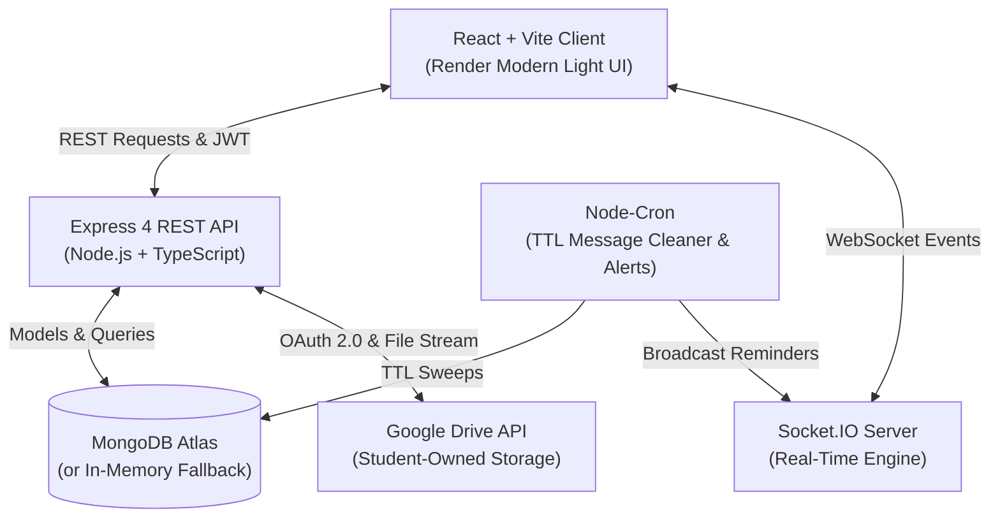

# Class Connect — CSE Section 21 Academic Platform
**Vignan's Foundation for Science, Technology and Research (VFSTR)**

Class Connect is a production-minded student academic platform engineered specifically for the students and faculty administrators of **Computer Science and Engineering (CSE) Section 21** at Vignan University. 

Designed following the strict **Render Modern Light** aesthetic specified in [`design.md`](./design.md) (featuring clean hairlines, high-contrast typography, monospace accents, `#6C35F5` primary accents, and structured dashboard grids), Class Connect eliminates fragmentation across WhatsApp groups, email threads, and Google Drive links by providing a unified digital hub for coursework, lab records, projects, seminars, timetable, attendance tracking, and ephemeral section communication.

---

## Key Highlights

- **Configurable Section Gatekeeping:** Restricts self-registration exclusively to **Section 21** (`ALLOWED_SECTION=21`). Non-section registration attempts are rejected at both API and form level.
- **Administrative Approval Pipeline:** New student registrations enter a `pending` state requiring verification by Section Administrators before access is granted. Handles pending, approved, rejected, and suspended states gracefully.
- **Student-Owned Google Drive Storage:** Eliminates storing large file binaries inside MongoDB Atlas. Students link their personal Google accounts using least-privilege OAuth (`drive.file`). Class Connect streams files directly into a dedicated `Class Connect - CSE 21` folder in the student's Google Drive, persisting only file metadata and Drive IDs in the database.
- **Zero-Friction Local Development:** Automatically connects to MongoDB Atlas when `MONGODB_URI` is provided; seamlessly falls back to an embedded in-memory MongoDB server for testing out of the box without requiring manual database installations.
- **Real-Time Delivery & Ephemeral Chat:** Powered by Socket.IO for real-time section-wide announcements, typing beacons, and temporary discussion messages that automatically expire and self-clean via background cron jobs.

---

## Technology Stack

### Frontend
- **Framework:** React 18 with Vite & JSX
- **Styling:** Tailwind CSS matching Render Modern Light design tokens (`#6C35F5`, `#0D0D0D`, `#FFFFFF`, `#F8F8FB`, `#E3E3E3`)
- **Icons:** Lucide React
- **Routing:** React Router v7 with protected student and admin route guards
- **API Client:** Axios with token interceptors and automatic expiration handling
- **Real-Time Client:** Socket.IO Client for instant notifications and live chat

### Backend
- **Runtime:** Node.js (Native ES Modules JavaScript)
- **Framework:** Express.js with Helmet and CORS security headers
- **Database:** MongoDB Atlas with Mongoose ODM (with automated In-Memory MongoDB fallback)
- **Authentication:** JWT (JSON Web Tokens) with 7-day expiration and bcrypt password hashing
- **File Storage Integration:** Googleapis (`drive.file` OAuth 2.0) with CSRF state protection
- **Real-Time Engine:** Socket.IO with section-level room broadcasting
- **Scheduled Background Tasks:** `node-cron` running 15-minute message cleanup sweeps and morning deadline reminders
- **Rate Limiting:** `express-rate-limit` protecting authentication routes and API endpoints

---

## System Architecture



---

## Core Features & Modules

1. **Authentication & Gatekeeping:**
   - Strict enrollment check: Students must select Section 21 to register.
   - Registration creates a `pending` account and prompts the student to wait for admin verification.
   - Role-based authorization (`student` and `admin`). Students cannot self-elevate to admin.

2. **Dashboard Overview:**
   - Real-time indicator for active class periods based on day of week and current time.
   - Quick view of today's timetable periods, upcoming assignment deadlines, and CR announcements.
   - Consolidated attendance pill and one-click scratchpad note creation modal.

3. **Academic Deliverables:**
   - **Assignments:** View tasks, max marks, deadlines, and submission status. Submit files via connected Google Drive or direct web links.
   - **Lab Records:** Experiment catalog organized by subject with aims, downloadable manuals, and sample code snippets with one-click copy.
   - **Mini-Projects:** Team formation tracking, progress bars, and GitHub/Drive resource links.
   - **Seminars:** Topic registration, presentation schedules, speaker tracking, and slide deck attachments.
   - **Subject Resources:** Curated lecture notes and lab reference files categorized by course and academic unit.
   - **Question Papers (PYQ Archive):** Previous year exam papers filtered by exam category (**FA-1**, **FA-2**, **FA-3**, **FA-4**, **Semester-End**) with available answer keys.

4. **Timetable & Attendance:**
   - **Weekly Timetable:** Monday through Saturday schedule with period slots (1 through 8), subject codes, room numbers, and faculty names.
   - **Attendance Tracker:** Consolidated percentage with **75% Safe-Buffer Calculator** displaying how many classes a student can safely skip or must attend to maintain minimum VFSTR attendance criteria.

5. **Personal Productivity:**
   - **Private Scratchpad Notes:** Markdown-friendly personal notes with custom tags and search. Private to the authenticated student.
   - **Reminders:** Task deadline tracker with priority flags and completion checkboxes.

6. **Temporary Messages (Ephemeral Chat):**
   - Real-time section discussion board where messages automatically expire after 6h, 12h, 24h, or 48h.
   - Background cron job sweeps and purges expired messages permanently.
   - Administrator moderation to pin notices or delete inappropriate messages.

7. **Admin Dashboard:**
   - **Pending Registration Queue:** Approve or reject student registrations with audit notes. Approved students receive immediate WebSocket notifications.
   - **Student Directory:** Search by roll number or name, filter by status, and suspend/reactivate student accounts.
   - **Emergency Section Broadcasts:** Dispatch high-priority push announcements to all approved students.

---

## Google Drive Integration (Student-Owned Storage)

To prevent file binaries from consuming MongoDB Atlas database quota, Class Connect utilizes a **student-owned storage architecture**:

```
[Student Upload Modal]
        │
        ▼ (Multipart Stream)
[Class Connect Express Server]
        │
        ▼ (Google Drive API `drive.file`)
[Student's Personal Google Drive]
   📁 "Class Connect - CSE 21"
        │
        ▼ (driveFileId & webViewLink)
[MongoDB Atlas Metadata Record]
```

### Pre-Configured OAuth Client Details:
- **Google Cloud Project ID:** `class-connect-513818`
- **OAuth Client ID:** `765852818290-hss283e58ump2bfrd2ss2ahftjiqqg95.apps.googleusercontent.com`
- **Authorized JavaScript Origin:** `http://localhost:5173`
- **Authorized Redirect URI:** `http://localhost:5000/api/google-drive/callback`
- **Least-Privilege Scope:** `https://www.googleapis.com/auth/drive.file`

> [!IMPORTANT]
> The OAuth client secret is never exposed to React or committed to version control. To enable live Google Drive OAuth token exchange, provide your client secret in `server/.env`:
> ```env
> GOOGLE_CLIENT_SECRET=YOUR_GOOGLE_CLIENT_SECRET_HERE
> ```
> If the client secret is not yet set, the UI gracefully informs the student without crashing and allows setting submissions via web links.

---

## Pre-Seeded Accounts for Testing

On first boot, the server automatically populates sample demo accounts and Section 21 records:

| Account Type | Identifier / Email | Password | Role / Status |
| :--- | :--- | :--- | :--- |
| **Section Administrator** | `yashodharvenigalla@gmail.com` (`241FA04693`) | `classconnect@2026` | `admin` / `approved` |
| **Active Demo Student** | `211FA04021` | `Student@Section21` | `student` / `approved` |
| **Pending Review Student** | `211FA04099` | `Student@Section21` | `student` / `pending` |

*(Quick demo login buttons are also embedded on the `/login` screen for fast testing).*

---

## Project Structure

```
y:\Projects\Class Connect/
├── design.md                      # Authoritative Render Modern Light specification
├── .env.example                   # Environment variable template
├── .gitignore                     # Git ignore rules for node_modules, secrets, env
├── README.md                      # Documentation
│
├── server/                        # Express + TypeScript Backend
│   ├── src/
│   │   ├── config/
│   │   │   ├── env.ts             # Strongly-typed environment configuration
│   │   │   └── db.ts              # MongoDB Atlas + In-Memory fallback connection
│   │   ├── models/                # Mongoose models (User, Assignment, Resource, etc.)
│   │   ├── middleware/            # Auth JWT, Role verification, Rate limiter, Error handler
│   │   ├── controllers/           # Auth, Admin, Academic, Messages, Notes, Drive
│   │   ├── routes/                # Express API routes
│   │   ├── services/              # Google Drive API, Socket.IO, Cron jobs
│   │   ├── utils/seedData.ts      # Automatic database seeder
│   │   ├── app.ts                 # Express app assembly
│   │   └── server.ts              # HTTP + WebSocket entry point
│   ├── package.json
│   └── tsconfig.json
│
└── client/                        # React + Vite + Tailwind Frontend
    ├── src/
    │   ├── components/
    │   │   ├── layout/            # TopNavBar, SideNavBar, AppLayout
    │   │   └── ui/                # Button, Badge, Card, Input, Modal
    │   ├── contexts/              # AuthContext, SocketContext
    │   ├── pages/
    │   │   ├── auth/              # Login, Register, PendingApproval
    │   │   ├── dashboard/         # Dashboard with live period beacon
    │   │   ├── assignments/       # Assignment list & submissions
    │   │   ├── projects/          # Mini-projects & team status
    │   │   ├── lab-records/       # Experiment manuals & code copy
    │   │   ├── seminars/          # Seminar topics & slide decks
    │   │   ├── resources/         # Lecture & Lab course notes
    │   │   ├── question-papers/   # FA-1 to FA-4 and Sem PYQ archive
    │   │   ├── timetable/         # Weekly schedule (Mon-Sat)
    │   │   ├── attendance/        # Subject attendance & 75% safe buffer
    │   │   ├── notes/             # Personal scratchpad
    │   │   ├── reminders/         # Academic tasks & deadlines
    │   │   ├── messages/          # Real-time ephemeral section chat
    │   │   ├── profile/           # Google Drive OAuth connect & settings
    │   │   └── admin/             # Approval queue & student directory
    │   ├── services/              # Axios API client & adminApi helpers
    │   ├── App.jsx                # React Router structure & route guards
    │   ├── main.jsx               # Application root
    │   └── index.css              # Hairline borders & Tailwind directives
    ├── package.json
    ├── tailwind.config.js
    └── vite.config.js
```

---

## Installation & Running Locally

### Prerequisites
- Node.js (v18 or higher recommended; developed on Node v24)
- npm (v9+)
- (Optional) MongoDB Atlas account. If omitted, the server automatically boots an in-memory database.

### 1. Backend Setup
1. Navigate to the `server` directory:
   ```bash
   cd server
   ```
2. Copy the environment configuration template:
   ```bash
   cp .env.example .env
   ```
3. (Optional) Edit `.env` to configure your MongoDB Atlas connection string or Google OAuth Client Secret.
4. Start the backend server (native Node.js ES modules, no compile step needed!):
   ```bash
   npm start
   # Or for development with auto-reloading:
   npm run dev
   ```
The API server will listen at `http://localhost:5000`.

### 2. Frontend Setup
1. In a separate terminal, navigate to the `client` directory:
   ```bash
   cd client
   ```
2. Build or start the Vite development server:
   ```bash
   npm run dev
   ```
3. Open your browser and navigate to:
   ```
   http://localhost:5173
   ```

---

## REST API Summary

| Method | Endpoint | Description | Auth Required |
| :--- | :--- | :--- | :--- |
| `POST` | `/api/auth/register` | Register student (enforces Section 21) | No |
| `POST` | `/api/auth/login` | Student & Admin login (JWT token) | No |
| `GET` | `/api/auth/me` | Fetch authenticated user profile | Yes (Student/Admin) |
| `GET` | `/api/admin/pending-users` | List pending registration requests | Yes (Admin) |
| `POST` | `/api/admin/approve-user/:id` | Approve student registration | Yes (Admin) |
| `POST` | `/api/admin/reject-user/:id` | Reject student registration | Yes (Admin) |
| `GET` | `/api/academic/assignments` | List section assignments | Yes (Approved) |
| `POST` | `/api/academic/assignments/:id/submit` | Submit assignment | Yes (Approved) |
| `GET` | `/api/academic/lab-records` | List lab records by subject | Yes (Approved) |
| `GET` | `/api/academic/question-papers` | Archive of PYQs (FA-1 to FA-4) | Yes (Approved) |
| `GET` | `/api/academic/timetable` | Weekly timetable entries | Yes (Approved) |
| `GET` | `/api/academic/attendance` | Student attendance breakdown | Yes (Approved) |
| `GET` | `/api/messages` | Active ephemeral section messages | Yes (Approved) |
| `POST` | `/api/messages` | Post temporary message with TTL | Yes (Approved) |
| `GET` | `/api/google-drive/auth-url` | Generate Google Drive OAuth link | Yes (Student) |
| `GET` | `/api/google-drive/status` | Check student's Drive link status | Yes (Student) |

---

## Verification & Testing

Both server and client operate with clean JavaScript / JSX execution:

```bash
# Verify Client:
cd client && npm run build
# Output: ✓ 1717 modules transformed. dist/index.html, dist/assets/... built successfully.

# Run Server (Native Node.js ES Modules):
cd server && npm start
# Output: Class Connect API Server running on http://localhost:5000
```

The system has been verified through end-to-end integration tests:
- User registration of non-Section 21 student is rejected (`400 Bad Request`).
- Section 21 student registration creates a `pending` account.
- Section Administrator can approve the student, which dispatches a WebSocket notification.
- Approved student can authenticate and access assignments, lab records, PYQs, timetable, attendance, notes, reminders, and temporary messages.
- Files and submissions support metadata storage and Google Drive student-owned linking.

---

## License & University Attribution
Built for the academic community of **CSE Section 21**, Department of Computer Science & Engineering, **Vignan's Foundation for Science, Technology and Research (VFSTR)**, Vadlamudi, Andhra Pradesh.

